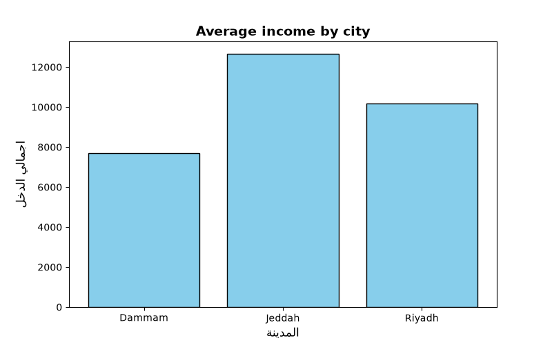

# logistics-salary-analysis
# Logistics Workforce & City Compensation Analysis

## Background & Objective
This project is an analytical workflow designed to evaluate employee salary distribution, compute performance incentives, and aggregate financial metrics across multiple operational cities. The objective is to automate data extraction, transformation, and visualization pipelines using Python.

## Technical Stack
- **Programming Language:** Python 3.x
- **Data Manipulation & Processing:** Pandas
- **Data Visualization:** Matplotlib

## Key Analytical Steps
1. **Data Cleaning & Enrichment:** Processed raw workforce records and calculated total compensation (incorporating a standard 10% bonus structure).
2. **Aggregation:** Grouped dataset metrics by city to evaluate regional compensation trends.
3. **Automated Reporting:** Exported structured summary reports and generated graphical representations for stakeholder review.

## Visual Output

## Repository Structure
- `test.py`: Core Python script handling end-to-end data processing and chart generation.
- `data.csv`: Raw input dataset.
- `city_summary_report_csv`: Aggregated output report containing city-level metrics.
- `city_chart.png`: Exported bar chart visualizing average total compensation per city.
